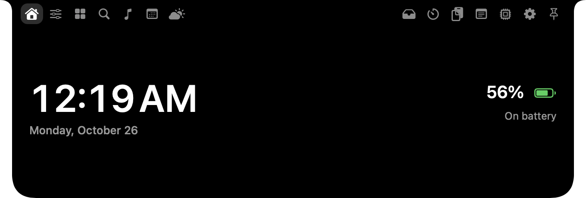

# Notch Island

Turn the MacBook notch (or a virtual pill on Macs without one) into an interactive island: hover to expand it into a tabbed panel with quick controls, your open apps, a launcher, music, calendar, weather, clipboard history, notes, system stats and more. Every feature can be switched off in Settings.


<!-- Add a screenshot or GIF at docs/screenshot.png -->

## Install
Requires macOS 13 or later and the Swift toolchain (Xcode or `xcode-select --install`).

```bash
git clone https://github.com/t27124949-cell/notch-island.git
cd notch-island
chmod +x build_app.sh
./build_app.sh
open NotchIsland.app
```
The app is unsigned, so if macOS blocks it, right-click `NotchIsland.app` and choose Open. Optionally drag it to Applications and enable "Open at login" in its Settings tab.

## Privacy
- Everything runs locally. The only network request is the Weather tab asking [Open-Meteo](https://open-meteo.com) for the forecast of the city you enter.
- Song lyrics are looked up on [LRCLIB](https://lrclib.net) and, if that has nothing, [lyrics.ovh](https://lyrics.ovh). They receive the artist, title and length of the current song. Turn off "Show song lyrics" in Settings to stop this.
- If you paste a Musixmatch key in Settings, the same details are also sent to Musixmatch for songs the other sources miss. The key is stored in this app's preferences on your Mac.
- Clipboard history is saved as **plain text** in `~/Library/Application Support/NotchIsland/clipboard.json` (owner-only permissions). Copies that password managers mark as concealed are skipped, but other sensitive text you copy will be stored. Turn off "Save history on this Mac" in Settings, or use "Clear all history now", to control this.
- Notes and settings are stored locally in UserDefaults.

## Features
Hover the notch and it expands into a tabbed panel (tab icons on both sides of the notch, pin button at the far right).

| Tab | What it does |
|---|---|
| **Home** | Clock, date, battery level |
| **Quick Controls** | Volume, mute, Wi-Fi, dark mode, keep awake, sleep display |
| **Open Apps** | Every running app; click to switch, right-click to hide/quit/force quit |
| **Launcher** | Search and launch any app, plus favourites |
| **Now Playing** | Spotify / Apple Music track and controls, a drag-to-seek progress bar, plus song lyrics when available (can be turned off in Settings)  Apple Music songs with lyrics saved in the file use those first. |
| **Calendar** | Next events through tomorrow |
| **Weather** | Current conditions and forecast (Open-Meteo, no key; change city and °C/°F) |
| **Shelf** | Drag files onto the notch to park them |
| **Timer** | Focus countdown |
| **Clipboard** | Searchable history of text you copy, saved on your Mac between launches |
| **Notes** | Scratchpad that autosaves |
| **System Stats** | CPU (with graph), memory, disk, network speed |
| **Settings** | Turn any tab on/off, hover vs click to open, delays, hover area, start tab, 24-hour clock, clipboard retention, launch at login |

- **Click outside** dismisses the island (can be turned off in Settings). **Pin** keeps it open.
- Runs as a menu-bar app (capsule icon) with no Dock icon. Menu: Toggle Notch, Debug Info, Quit.

## Build & run (macOS 13+, Xcode or Command Line Tools)
```bash
chmod +x build_app.sh
./build_app.sh
open NotchIsland.app
```
Use the built `.app` rather than `swift run`: the permission prompts below need the app's Info.plist.

## Permissions (asked the first time you use each tab)
- **Calendar** — Allow Calendar Access button on the Calendar tab (full access is required to read events).
- **Automation** — the first time Now Playing finds Spotify or Music running, macOS asks whether Notch Island may control it. If you said no: System Settings → Privacy & Security → Automation.

## Notes
- **Now Playing uses AppleScript, not MediaRemote.** Apple's private MediaRemote framework is blocked for third-party apps on recent macOS, so this talks to Spotify and Music directly. Other players (browsers, VLC, etc.) are not detected. Spotify artwork is fetched from its URL; Apple Music artwork is best-effort and falls back to a note icon. The player is only polled while the Now Playing tab is visible, and never launched for you.
- **Clipboard** history is text only. With "Save history on this Mac" on (default) it is stored as plain-text JSON in `~/Library/Application Support/NotchIsland/clipboard.json` (owner-only permissions), pruned by the retention period (default 30 days) and max items. Copies flagged concealed/transient by password managers are skipped. Settings → Clear all history now wipes memory and the file; turn the switch off to stop saving.
- Notch size is read from `NSScreen.safeAreaInsets` and the auxiliary top areas, so it adapts to each MacBook.
- The panel is only notch-sized while closed, so it doesn't block the menu bar.

## Layout
| File | Role |
|---|---|
| `main.swift` / `AppDelegate.swift` | App entry, menu bar item |
| `NotchController.swift` | Floating panel above the menu bar, notch geometry, pointer polling for hover |
| `NotchModel.swift` | Shared state, tabs, shelf, timer, battery |
| `IslandView.swift` | The island itself: animated shape, tab bar, drag-and-drop target (plain AppKit) |
| `IslandTabs.swift` | The seven tab pages (plain AppKit) |
| `NowPlaying.swift` | Spotify + Music via AppleScript |
| `CalendarStore.swift` | EventKit access and upcoming events |
| `ClipboardStore.swift` | Pasteboard polling and history |
| `AppsStore.swift` | Running apps list and switch/hide/quit actions |

## Adding your own tab
1. Add a case (and SF Symbol) to `NotchTab` in `NotchModel.swift`, and put it in `leftTabs` or `rightTabs`.
2. Create a `TabContentView` subclass in `IslandTabs.swift` and register it in `buildTabs()` in `IslandView.swift`.
3. Add any new file to `sources` in `Package.swift`.

## Why AppKit, not SwiftUI
On macOS 27 a SwiftUI view hosted in this non-activating panel did not redraw when the island was opened by the pointer-polling timer (only when clicked). The UI is plain AppKit + Core Animation instead.

## Troubleshooting
Menu bar capsule icon → **Debug Info…** shows the pointer tracking state and a recent event log (also written to `~/Library/Logs/NotchIsland.log`). Include it when reporting a bug.

## License
MIT, see [LICENSE](LICENSE).
